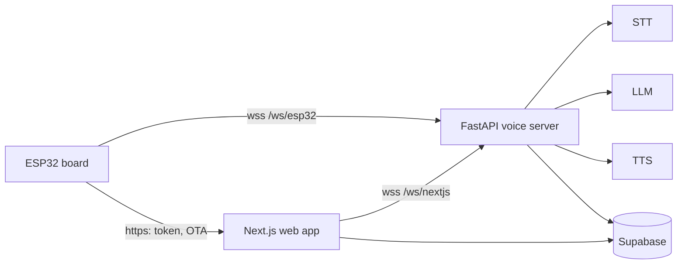

English | [中文](README.zh.md)

# aibuddy

A Cantonese AI companion toy for young children: an ESP32 board that holds a
voice conversation with a character, a web app where parents pick the
character and see the history, and one voice server behind both.

Forked from [ElatoAI](https://github.com/akdeb/ElatoAI) (MIT, see
[LICENSE](LICENSE)). Only its FastAPI route is kept; the Deno and Cloudflare
backends were removed.

## Components

| Directory | What it is |
|-----------|------------|
| [`server/fastapi`](server/fastapi) | The voice server: Pipecat `STT -> LLM -> TTS`, long-term memory, character prompts. Boards connect to `/ws/esp32`, the web app to `/ws/nextjs`. |
| [`frontend-nextjs`](frontend-nextjs) | The parent web app and the device backend (auth token, OTA, factory reset). |
| [`firmware-arduino`](firmware-arduino) | The ESP32 firmware (PlatformIO). Supported boards are in [BOARDS.md](firmware-arduino/BOARDS.md). |
| [`supabase`](supabase) | Database schema and migrations. Users, devices, characters, conversations and memory all live here. |

## Running it

- Voice server: [server/fastapi/README.md](server/fastapi/README.md), Quick Start.
- Web app: [frontend-nextjs/README.md](frontend-nextjs/README.md).
- Firmware: `cd firmware-arduino && pio run -e <env> -t upload`. `PROD_MODE`
  (the default in `src/Config.h`) talks to the deployed host; the `-localws`
  envs in `platformio.ini` send only the voice socket to a machine on the LAN.
- Database: migrations in `supabase/migrations`; `scripts/supabase-migrate.sh`
  applies them.

## License

MIT, see [LICENSE](LICENSE).
