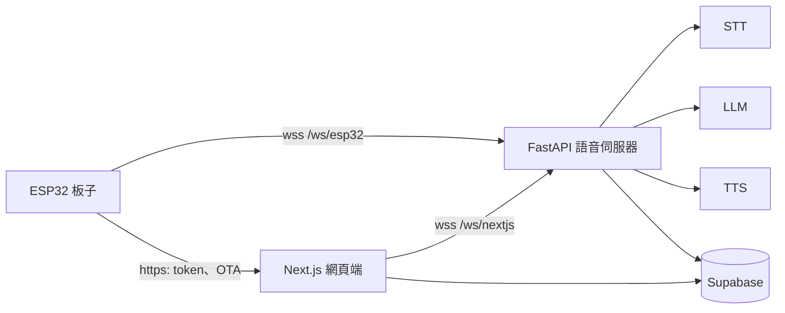

[English](README.md) | 中文

# aibuddy

給幼兒的粵語 AI 陪伴玩具：ESP32 板子和角色語音對話；家長在網頁端選角色、看對話記錄；兩者背後是同一個語音伺服器。

本項目 fork 自 [ElatoAI](https://github.com/akdeb/ElatoAI)（MIT，見 [LICENSE](LICENSE)），只保留其 FastAPI 路線，Deno 與 Cloudflare 後端已移除。

## 組成

| 目錄 | 內容 |
|------|------|
| [`server/fastapi`](server/fastapi) | 語音伺服器：Pipecat `STT -> LLM -> TTS`、長期記憶、角色提示詞。板子連 `/ws/esp32`，網頁端連 `/ws/nextjs`。 |
| [`frontend-nextjs`](frontend-nextjs) | 家長網頁端，以及板子用的後端（取 token、OTA、恢復出廠）。 |
| [`firmware-arduino`](firmware-arduino) | ESP32 韌體（PlatformIO）。支援的板子見 [BOARDS.md](firmware-arduino/BOARDS.md)。 |
| [`supabase`](supabase) | 資料庫結構與 migration。用戶、裝置、角色、對話和記憶都在這裡。 |

## 怎樣跑起來

- 語音伺服器：見 [server/fastapi/README.md](server/fastapi/README.md) 的 Quick Start。
- 網頁端：見 [frontend-nextjs/README.md](frontend-nextjs/README.md)。
- 韌體：`cd firmware-arduino && pio run -e <env> -t upload`。`src/Config.h` 預設 `PROD_MODE`，連部署好的主機；`platformio.ini` 裡的 `-localws` 環境只把語音 socket 改連區網裡的電腦。
- 資料庫：migration 在 `supabase/migrations`，用 `scripts/supabase-migrate.sh` 套用。

## 授權

MIT，見 [LICENSE](LICENSE)。
